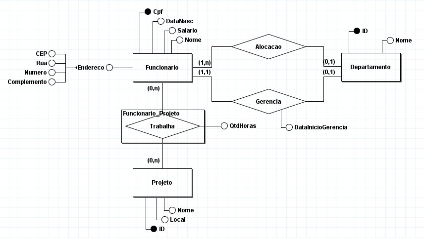
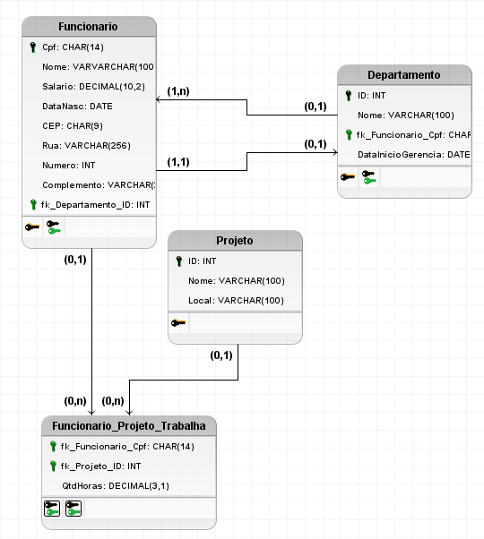

# 09/10

## Transações

Uma **transação** é um conjunto de operações SQL executadas como uma única unidade de trabalho, garantindo que os dados permaneçam consistentes mesmo quando ocorrem erros.

- `BEGIN TRANSACTION`: inicia uma transação.
- `COMMIT`: confirma as alterações realizadas.
- `ROLLBACK`: desfaz as alterações realizadas pela transação.

### Propriedades ACID

As transações devem seguir quatro propriedades fundamentais, conhecidas como **ACID**:

- **Atomicidade:** todas as operações são concluídas ou todas são desfeitas em caso de falha.
- **Consistência:** garante que os dados respeitem as regras e restrições do banco.
- **Isolamento:** evita interferências indevidas entre transações executadas simultaneamente.
- **Durabilidade:** garante que as alterações confirmadas sejam persistidas, mesmo após falhas do sistema.

### Tratamento de erros (TRY...CATCH)

O SQL Server utiliza `TRY...CATCH` para identificar e tratar erros durante a execução de comandos SQL.

- `BEGIN TRY`: inicia o bloco de execução.
- `BEGIN CATCH`: inicia o bloco de tratamento de erros.
- `ERROR_MESSAGE()`: retorna a mensagem do erro ocorrido.
- `@@TRANCOUNT`: informa a quantidade de transações abertas na conexão.

### Estrutura

```
BEGIN TRY
    BEGIN TRANSACTION;

    -- Operações SQL

    COMMIT TRANSACTION;
END TRY
BEGIN CATCH
    IF @@TRANCOUNT > 0
        ROLLBACK TRANSACTION;

    SELECT ERROR_MESSAGE() AS Erro;
END CATCH;
```

Se as operações forem executadas com sucesso, o `COMMIT` confirma as alterações. Caso ocorra um erro capturável, o fluxo passa para o `CATCH`, onde o `ROLLBACK` desfaz a transação, se ainda houver uma aberta.


# 31/07

## Como funcionarão as aulas

- As aulas **não seguirão as unidades de forma linear**.

### Avaliação

- **1ª e 2ª notas:**
  - Exercícios: **3,0 pontos**
  - Prova: **7,0 pontos**

- **3ª nota:**
  - Trabalho: **10,0 pontos**


## Modelo Entidade-Relacionamento Conceitual (ER)

O **Modelo Entidade-Relacionamento (MER)** é uma representação conceitual utilizada para modelar bancos de dados. Seu objetivo é identificar as entidades, seus atributos e os relacionamentos existentes entre elas.

## Elementos do MER

### Entidade
- Representada por um **retângulo**.
- Corresponde a um objeto ou conceito do mundo real sobre o qual se deseja armazenar informações.
- Exemplos: **Aluno**, **Professor**, **Produto**, **Cliente**.

### Atributo
- Representado por uma **elipse (oval)**.
- São as características que descrevem uma entidade.
- Exemplos:
  - Aluno → Nome, Matrícula, Data de Nascimento.
  - Produto → Código, Nome, Preço.

### Relacionamento
- Representado por um **losango**.
- Indica como duas ou mais entidades se relacionam.
- Exemplos:
  - Aluno **cursa** Disciplina.
  - Cliente **realiza** Pedido.

### Cardinalidade
Indica a quantidade de ocorrências de uma entidade que podem estar associadas à outra.

Tipos mais comuns:
- **1:1 (Um para Um)**
- **1:N (Um para Muitos)**
- **N:N (Muitos para Muitos)**


## Função do SGBD

O **SGBD (Sistema Gerenciador de Banco de Dados)** é responsável por gerenciar os dados armazenados em um banco de dados.

Principais funções:
- Evitar a duplicidade de dados.
- Garantir a integridade das informações.
- Controlar o acesso aos dados.
- Facilitar consultas, inserções, atualizações e exclusões de informações.
- Realizar controle de concorrência e recuperação em caso de falhas.

## Exercício de Aula (Funcionario-Departamento)

### Modelo Conceitual 


### Modelo Lógico
